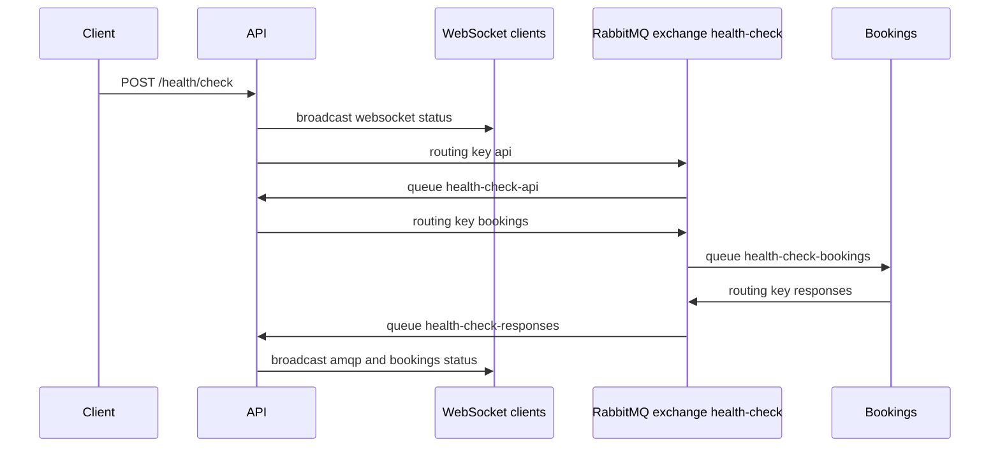

# Seat booking

A small learning app for layered tests and a message-driven health check between two Node services.

The product surface is a health check, not seat reservations yet. `api` is the public HTTP and WebSocket edge. `bookings` is the service behind it. They talk through a RabbitMQ topic exchange. Postgres is there so the API proves it can open a database connection on startup.

Requires Node 22 and Yarn 1. Docker is required for anything that talks to Postgres or RabbitMQ.

## Architecture



| Piece | Role |
|---|---|
| `api` | Express on port 4000. `GET /health/check` returns `{status: "ok"}`. `POST /health/check` with `{"data": "<string>"}` checks the WebSocket server, then asks bookings over RabbitMQ and broadcasts the result to connected WebSocket clients. On startup it runs `SELECT NOW()` against database `api_dev`. |
| `bookings` | Express on port 4100. `GET /health/check` returns `{status: "ok"}`. Listens on queue `health-check-bookings` and answers on routing key `responses`. |
| `ext_containers/amqp` | RabbitMQ 4.4 with the management UI. Definitions are imported after the broker boots, because RabbitMQ 4.4 hangs if they are loaded during startup. |
| `ext_containers/pg` | Postgres 16. Creates `user1` / `pass1`, databases `api_dev` and `bookings`. |
| `e2e_test` | Mocha tests that call a running API on `localhost:4000` and listen on its WebSocket. |
| `frontend` | Plain web components, tested in the browser with Web Test Runner. Not part of the compose stack. |
| `seat-booking-fe` | React and Vite, tested with Vitest. Not part of the compose stack. |

RabbitMQ vhost is `dev`. User is `guest` / `guest` (loopback restriction is turned off so other containers can connect).

Exchange `health-check` (topic) on vhost `dev`:

| Routing key | Queue |
|---|---|
| `api` | `health-check-api` |
| `bookings` | `health-check-bookings` |
| `responses` | `health-check-responses` |

A second vhost, `test-queue`, exists for experiments. The running services use `dev`.

Environment files use indirection. A value such as `PG_PASSWORD=API_PG_PWD` means "use the `API_PG_PWD` environment variable when it is set, otherwise use the literal". Compose sets `API_PG_PWD=pass1`, which matches `user1`.

## Run everything in Docker

`./start.sh` builds the images and starts Postgres, RabbitMQ, `api`, and `bookings`. Nothing else has to be running on the host. The first run downloads the images, so it takes a few minutes.

```bash
./start.sh
```

| URL | What |
|---|---|
| http://localhost:4000/health/check | API |
| http://localhost:4100/health/check | Bookings |
| http://localhost:8881 | RabbitMQ management, `guest` / `guest` |
| `localhost:5432` | Postgres, `user1` / `pass1` |

Inside the dev containers, `yarn start:dev` compiles TypeScript and nodemon restarts the process when `dist` changes. `api/src` and `bookings/src` are mounted from the repo, so a save is picked up when Docker delivers the file event. If a save does nothing, run `./start.sh` again.

`docker compose up` without `-f docker-compose-dev.yaml` builds the production image (`node dist/src/app.js`, no file watch). Use `./start.sh` for local development.

Stop it with:

```bash
docker compose -f docker-compose-dev.yaml down
```

Postgres data stays in `./postgresdata`.

## Run the Node services on the host

Use this when you want `api` and `bookings` in your terminal, with Postgres and RabbitMQ still in Docker. Stop the app containers first if the full stack is already up, or port 4000 and 4100 are taken:

```bash
docker compose -f docker-compose-dev.yaml up -d postgres rabbit-dev
docker compose -f docker-compose-dev.yaml stop api bookings
```

`variables.env.example` is written for containers (`PG_HOST=postgres`, `AMQP_HOST=DOCKER_AMQP_HOST`). On the host, write literals. A value is used as-is unless a variable of that same name exists in the environment.

`api/variables.env`:

```
PG_HOST=127.0.0.1
PG_PORT=5432
PG_USERNAME=user1
PG_PASSWORD=pass1
AMQP_USERNAME=guest
AMQP_PASSWORD=guest
AMQP_HOST=127.0.0.1:5672
AMQP_VHOST=dev
SERVER_PORT=4000
```

`bookings/variables.env`:

```
PG_HOST=127.0.0.1
PG_PORT=5432
PG_USERNAME=user1
PG_PASSWORD=pass1
SERVER_PORT=4100
AMQP_USERNAME=guest
AMQP_PASSWORD=guest
AMQP_HOST=127.0.0.1:5672
AMQP_VHOST=dev
```

Then, in two terminals:

```bash
cd api && yarn install && yarn start:dev
cd bookings && yarn install && yarn start:dev
```

`start:dev` runs `tsc --watch` and nodemon. The API log should include `Running on port 4000` and `Starting DB connection`. Bookings should log `Listening on port 4100`. If either process exits immediately, RabbitMQ or Postgres is not reachable yet.

`variables.env` is gitignored.

## Try the running services

These calls work the same whether the processes are in Docker or on the host.

```bash
curl -sS http://localhost:4000/health/check
curl -sS http://localhost:4100/health/check
curl -sS http://localhost:4000/hello/world
```

The first two return `{"status":"ok"}`. The hello route returns plain text.

`POST /health/check` answers immediately with the WebSocket connection count. The RabbitMQ and bookings status is pushed to WebSocket clients, not returned in the HTTP body. Open a socket, then post. The listener below prints only the event for this call, because the responses queue also replays older health checks to every new client:

```bash
node --input-type=commonjs -e '
const WebSocket = require("./api/node_modules/ws");
const ws = new WebSocket("ws://localhost:4000");
ws.on("message", (data) => {
  const event = JSON.parse(data.toString());
  if (event.message === "hello from curl") console.log("ws", event);
});
ws.on("open", () => {
  setTimeout(() => {
    fetch("http://localhost:4000/health/check", {
      method: "POST",
      headers: { "Content-Type": "application/json" },
      body: JSON.stringify({ data: "hello from curl" })
    }).then((r) => r.json()).then((body) => console.log("http", body));
  }, 200);
});
'
```

Run that from the repo root. The HTTP body looks like `{status: {websocket: {status: "ok", connections: 1}}}`. The socket then prints a health check with `ws.status` `connected`, and another with `amqp.status` `connected` and `bookings.status` `ok`.

### Postman

The WebSocket does not take a message from you. Connecting is enough, and the health check is a separate HTTP request. Keep both tabs open.

1. **New → WebSocket**. URL: `ws://localhost:4000`. There is no path. Click **Connect**.
2. The **Messages** pane immediately gets one frame:

```json
{"__type":"HealthCheck","ws":{"status":"connected"},"amqp":{"status":"unknown"},"message":"Hello from WebSocket!"}
```

3. Leave that socket connected. In another tab, **New → HTTP**. `POST http://localhost:4000/health/check`. Body type **raw / JSON**:

```json
{"data":"hello from postman"}
```

4. Send the HTTP request. Its response is only the connection count, for example `{"status":{"websocket":{"status":"ok","connections":1}}}`.
5. Switch back to the WebSocket tab. New frames show up there: one with `ws.status` of `connected`, then one with `amqp.status` of `connected` and `bookings.status` of `ok`, and `"message":"hello from postman"`.

Anything still sitting on the `health-check-responses` queue is broadcast to this client too, so older health checks can appear between those two frames. You do not need to type into the WebSocket message box.

RabbitMQ management is at http://localhost:8881 (`guest` / `guest`), vhost `dev`. After the POST, queues `health-check-api`, `health-check-bookings`, and `health-check-responses` have been used.

The same path is what `e2e_test` asserts. With the services up:

```bash
cd e2e_test && yarn install && yarn test
```

## Tests

Each package has its own `yarn install`. Suites are split by how much of the system they need.

### No Docker

```bash
cd api && yarn test:unit
cd ../bookings && yarn test:unit
cd ../bookings && yarn test:integration
cd ../frontend && yarn install && yarn test
cd ../seat-booking-fe && yarn install && yarn test
```

`api` unit tests have one unfinished case in `api/test/unit/server/server.test.ts` (`expect(true).to.eql(false)`). The rest of that file passes.

`frontend` runs in Chrome via Web Test Runner. `seat-booking-fe` runs Vitest. `yarn test` there starts Vitest in watch mode; `yarn test --run` runs once.

`bookings` also has `test/component/startup/component-startup.ts`, but `yarn test:component` only picks up `*.test.ts`, so that file is not part of the script.

### With the stack running

Start compose as above. From the host, `test.env` points RabbitMQ at the hostname `rabbit-dev`, which only resolves inside the Docker network. Export the published port before the suites that open their own AMQP connection. Dotenv will keep that value.

```bash
export AMQP_HOST=127.0.0.1:5672

cd api && yarn test:deployment
cd ../bookings && yarn test:deployment
cd ../e2e_test && yarn install && yarn test
```

`e2e_test` calls `http://localhost:4000` and its WebSocket. It covers the HTTP health check, the WebSocket broadcast, the RabbitMQ status, and the bookings reply.

`api` `yarn test:component` is split. The RabbitMQ producer test passes with `AMQP_HOST` set. `api/test/component/tmp/app-health-check.test.ts` opens Postgres at the hostname `postgres` and, if that name does not resolve, leaves the process running. Add `127.0.0.1 postgres` to `/etc/hosts` before running it.

`yarn test` in `api` or `bookings` runs every `*.test.ts` under `test/`, including deployment tests, so the stack and `AMQP_HOST` need to be in place.
